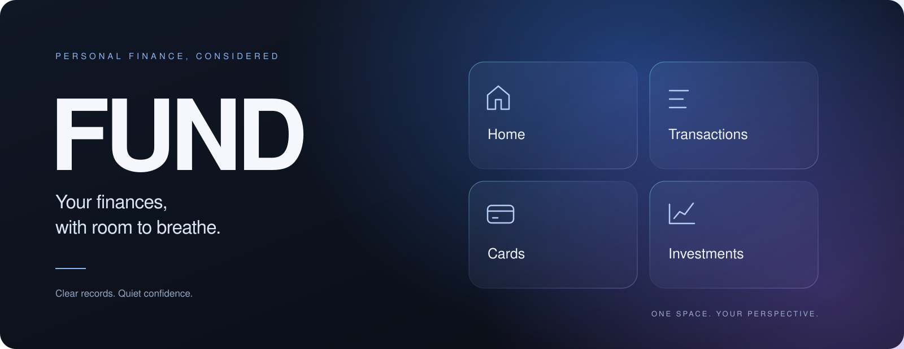
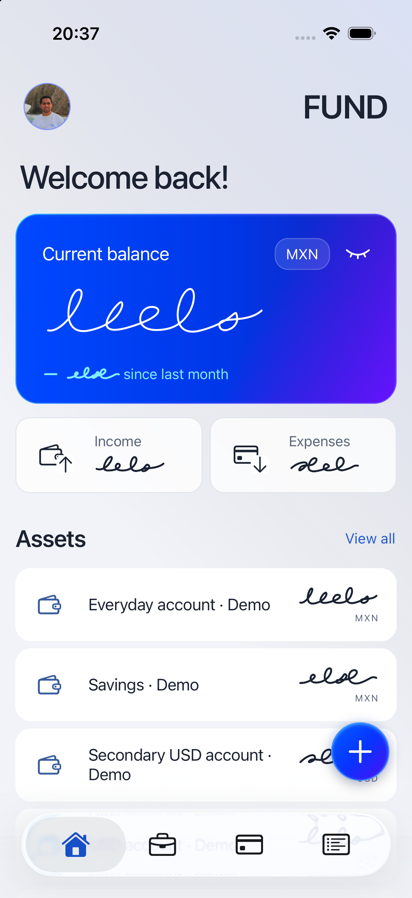
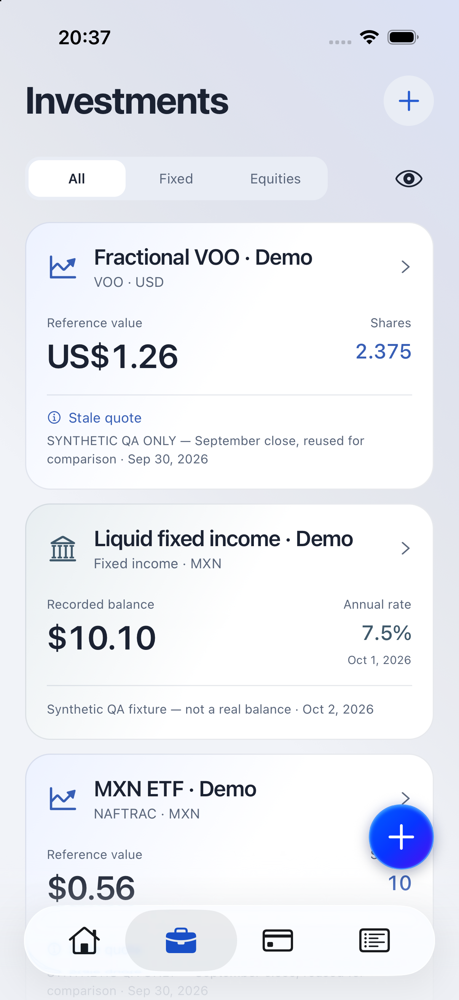
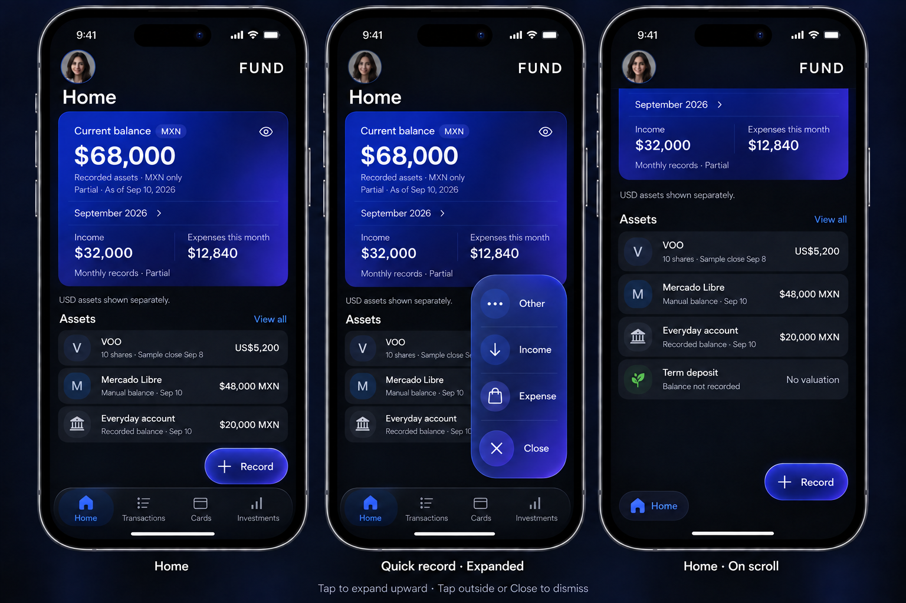
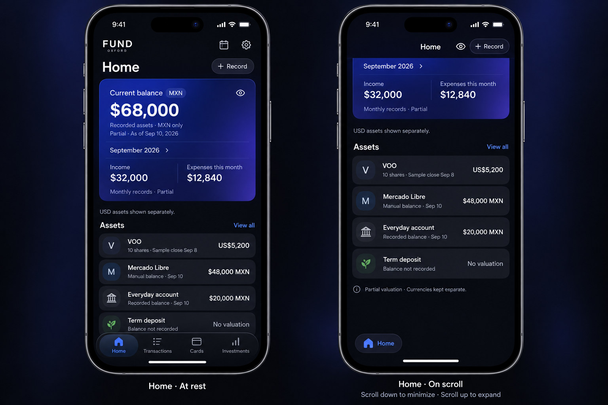

**Personal finance. Clear records. A calmer perspective.**

Income, expenses, cards and investments in a considered native experience.

## About Fund

Fund is a personal finance mobile application built to make everyday financial information easier to review and maintain. Start with what you know, keep original currencies, and see when information is incomplete or out of date—without scores, streaks or pressure to reconstruct your entire history.

This public repository presents the product, its visual direction and selected technical decisions. **The application's source code is maintained in a separate private repository.**

## The experience

| Area | What it brings together |
| --- | --- |
| Home | Known account and investment values, monthly income and expenses, and independent MXN/USD display. |
| Transactions | Income and expense entry, month filters, search, original-currency details, corrections, deletion and undo. |
| Cards | A card carousel, statement periods, recorded payments and separately confirmed payment application. |
| Investments | Fixed income and equities, fractional purchases, dated observations, valuation references and linked history. |

Four native iOS tabs anchor navigation. A separate floating plus opens Expense, Income and Investment. Oxford charcoal, blue and violet accents, subtle frosted surfaces, and Light/Dark/System appearance define the visual direction.

## Native app · Light mode

These screenshots were supplied by the app's creator and show the running native application in Light appearance with demo records. Home demonstrates discreet mode, replacing financial amounts with handwritten masks. Investments shows synthetic QA positions and explicitly dated reference information; the displayed quotes, balances and rates are test fixtures, not live market data.

<table>
  <tr><th>Home · Discreet mode</th><th>Investments</th></tr>
  <tr>
    <td></td>
    <td></td>
  </tr>
</table>

## Earlier design exploration

The existing images below are **AI-generated design mockups with fictional data**, not screenshots of the running native app. They document earlier design exploration; navigation, currency treatment and quick-entry labels have since evolved. They are included as visual references rather than proof of current behavior.

### Home and quick entry

### Earlier Home exploration

The cover is brand artwork. All amounts, dates, holdings and the portrait in these mockups are fictional.

## Engineering approach

Fund uses **TypeScript, React Native, Expo SDK 57 and local SQLite persistence**, with a hexagonal architecture:

- **Domain:** pure financial rules and exact decimal arithmetic with explicit rounding.
- **Application:** use cases, contracts and outgoing ports.
- **Infrastructure:** persistence, market-reference and device adapters.
- **Presentation:** native screens that invoke application contracts.
- **Composition root:** explicit dependency injection to wire the layers together.

Financial meaning stays explicit: missing values do not become zero; card payments do not duplicate purchase expenses; investment principal and valuation changes are distinct from received income. Currency display preserves original records, and quotes retain source and reference dates.

## Development status

The native Home, Transactions, Cards and Investments workflows, financial core and local persistence are implemented. Physical-device acceptance for materials, motion, accessibility and device capabilities remains ongoing. This showcase does not announce an App Store release or provide an installable build.

Fund focuses on recording and reviewing financial information. Bank synchronization, payment or trade execution, forecasts and investment recommendations are outside the current scope.

## Source availability

The source code remains private while this repository provides a public overview of the application. No future open-source release is promised. This repository contains presentation material only, with no application source, credentials or personal financial records.
